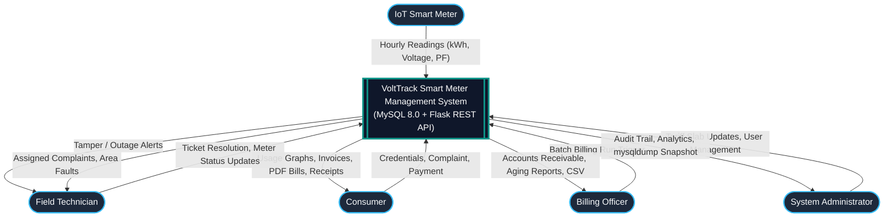
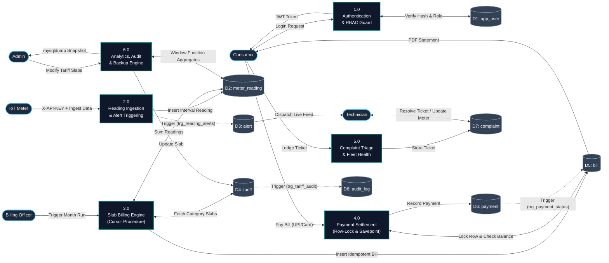

# VoltTrack: Data Flow Diagrams (DFD)

This document specifies the Data Flow Diagrams (Level 0 Context Diagram and Level 1 Detailed DFD) for the **VoltTrack Smart Meter Data Management System**.

---

## 1. DFD Level 0: Context Diagram

The context diagram represents the high-level boundary of the VoltTrack system, its external entities (Consumers, Field Technicians, Billing Officers, Administrators, and IoT Smart Meters), and the primary data streams entering and exiting the platform.

---

## 2. DFD Level 1: Subsystem Process Decomposition

The Level 1 DFD decomposes the system into six core automated processes and highlights interactions with the normalized MySQL datastores.

