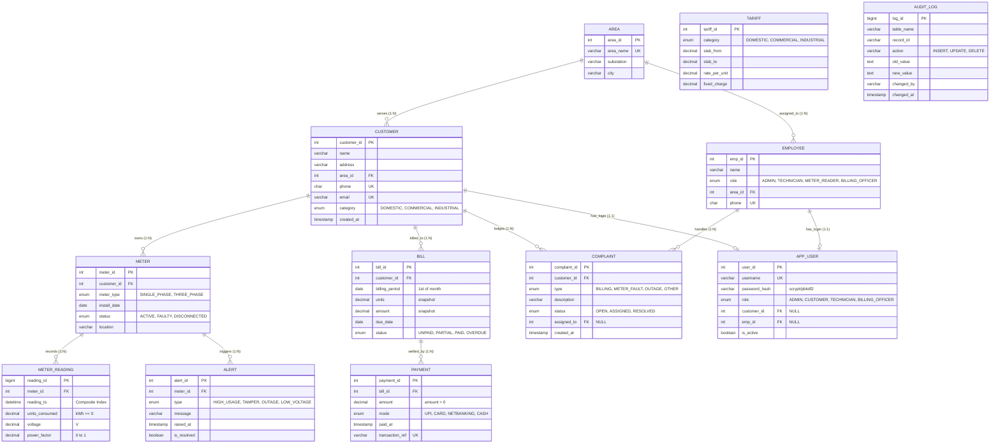

# VoltTrack: Entity-Relationship (ER) Diagram

This document contains the complete Entity-Relationship diagram for the **VoltTrack Smart Meter Data Management System** modeled for **MySQL 8.0 (InnoDB)**.

---

## Mermaid ER Diagram

---

## Entity Cardinalities Summary

| Relationship | Cardinality | Business Rules & Notes |
| :--- | :---: | :--- |
| **Area &rarr; Customer** | `1 : N` | Each substation area services multiple customers. Foreign key `customer.area_id`. |
| **Area &rarr; Employee** | `1 : N` | Field technicians and meter readers operate within designated substation sectors. |
| **Customer &rarr; Meter** | `1 : N` | A customer owns 1 or more meters (e.g. commercial complexes own multiple meters). |
| **Meter &rarr; Meter_Reading** | `1 : N` | High-frequency time-series table. Composite indexed on `(meter_id, reading_ts)`. |
| **Meter &rarr; Alert** | `1 : N` | Alerts automatically generated by database triggers (`trg_reading_alerts`). |
| **Customer &rarr; Bill** | `1 : N` | Unique invoice per customer per calendar month via `UNIQUE(customer_id, billing_period)`. |
| **Bill &rarr; Payment** | `1 : N` | Partial payments permitted. Status automatically synchronized via `trg_payment_status`. |
| **Customer &rarr; Complaint** | `1 : N` | Support tickets lodged by consumers. Assigned to field technicians. |
| **Employee &rarr; Complaint** | `1 : N` | Field technician handles and resolves multiple repair tickets. |
| **App_User &rarr; Customer/Employee** | `1 : 1 (opt)` | Single authentication table with polymorphic foreign keys and RBAC role claims. |
